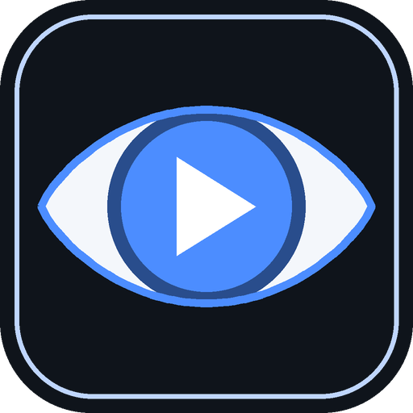

<p align="center"></p>

# BreakFromAeye 👁

**English** · **[Italiano](README.it.md)**

> *A break from AI + eye.* Look away from your PC and your video starts.

[](https://github.com/lorenzovitale1/BreakFromAeye/actions/workflows/tests.yml)
[](LICENSE)


Watching a video on your **tablet** while you work at your **PC**? This program uses **only your PC webcam** to tell whether you are looking at the screen
and plays or pauses the video accordingly. No eye tracker, no cloud: everything runs locally.

| Output | You look away (≥ 1.5 s) | You look back at the PC (≥ 0.8 s) |
|---|---|---|
| 📱 **Android tablet** (ADB over Wi-Fi) | **PLAY** | **PAUSE** |
| 🖥 **Video on the PC** (YouTube etc. in the browser) | **PAUSE** | **PLAY** |

Timings and actions are configurable from the interface. Tablet and PC can be used **separately or together**.
The interface is available in **English and Italian** (automatic, following the Windows language; change it in *Settings → Interface → Language*).

## Features
- **Quick tablet / PC / both switch** on the main screen (and in the tray-icon menu).
- **Tablet pairing with a QR code**: scan the code shown by the program and Wireless debugging connects by itself.
- **Safe areas**: zones where looking does *not* count as "looking away" (e.g. the keyboard). Define them by looking at the 4 corners
  (with start/end beeps, since you cannot see dots outside the screen), by drawing on the map, or by typing coordinates.
- **Multiple monitors**: evaluate your gaze on all screens or on just one, with a separate saved calibration for each choice.
- **Runs in the background**: closing the window sends the program to the notification area (the ^ arrow near the clock) — no black console window.
  Configurable in *Settings → Interface*.
- 9-point calibration, false-trigger protection (blinks, quick glances), exactly one command per transition, *dry-run* mode.
- Webcam unplugged/frozen/covered → "uncertain" state and **no commands**. No frame is ever saved or sent over the network.

## Install (Windows 10/11)

**Recommended — installer** (no Python needed; it bundles everything: the detection model and `adb`)
1. Download `BreakFromAeye-Setup-<version>.exe` from the [Releases](https://github.com/lorenzovitale1/BreakFromAeye/releases) page.
2. Run it: it installs for your user only (no administrator rights). You can choose a Desktop shortcut and start with Windows.
   The installer is available in English and Italian (it follows the Windows language).
3. The program appears in the Start menu and in *Apps & features* (uninstall from there).

> Windows may show *"Windows protected your PC"* because the installer is not signed with a paid certificate:
> click **More info → Run anyway**. All the code is here, and the installer is built automatically by GitHub Actions.

**From source** — you need Windows 10/11, a webcam and **Python 3.10–3.12** ([python.org](https://www.python.org/downloads/) or `winget install Python.Python.3.12`).

**A) Download the ZIP**
1. On the repository page: **Code → Download ZIP**, extract it wherever you like.
2. Double-click **`setup.bat`** and answer the questions (detection model ~4 MB, `adb` ~8 MB only if you use the tablet, Desktop shortcut).
3. Start it from the **BreakFromAeye** Desktop shortcut (or `start.vbs`).

**B) With git**
```bash
git clone https://github.com/lorenzovitale1/BreakFromAeye.git
cd BreakFromAeye
setup.bat
```

**C) With pip / pipx** (personal data goes to `%APPDATA%\BreakFromAeye`)
```bash
pipx install git+https://github.com/lorenzovitale1/BreakFromAeye.git
breakfromaeye --setup      # downloads the model and adb, asking first
breakfromaeye-gui          # starts without a console window
```
Every download is optional and asked for first; the model is verified with SHA-256.

## First start
1. The program offers the **calibration** (~30 s): follow the 9 points with your eyes.
2. On the **Status** tab look at the *gaze map*: the blue rectangle is your screen. If it triggers while you look at the edges, raise *Screen margin*.
3. Try `start-dryrun.bat` first (shows the commands without sending them; the **DRY-RUN** badge is visible), then start normally.
4. For the first few seconds it "settles": it sends nothing and adopts the current state.

## Android tablet (ADB over Wi-Fi)
On the tablet (Android 11+): *Settings → Developer options → **Wireless debugging***, with tablet and PC on the **same trusted network**.
1. Tap the **label** "Wireless debugging" (not the switch) to open the pairing page.
2. **Pairing — fastest way, with a QR code**: in the app press **📷 Pair with QR code…**; on the tablet choose *Pair device with QR code* and scan the code shown on the PC.
   The program finds the tablet on the network, completes the pairing and connects it by itself.
   *Alternative, with the 6-digit code:* **Pair…** → *pairing* IP:port + code, then **Connect IP…** → IP:port of the main page (the port is different).
3. **Refresh**, pick the tablet from the list, then **Test PLAY / Test PAUSE** with a video already open on the tablet.

The QR contains a random name and password, valid only for that session (2 minutes). If pairing does not start, make sure PC and tablet are on the same Wi-Fi
network ("guest" networks often block device discovery) and fall back to the 6-digit code.

Distinct, idempotent commands (`keyevent 126` = PLAY, `127` = PAUSE), not a toggle. Some apps **ignore** media keys: then set *Method* to `toggle_if_needed`
(it reads the player state with `dumpsys media_session`). DRM or protections are never bypassed.
Android < 11: first connect with a USB cable and run `adb tcpip 5555`. If several devices are connected you must pick one: nothing is ever sent to an unselected device.
Do not enable wireless debugging on untrusted networks; pairing codes are never logged.

## Video on the PC (YouTube, also on a second monitor)
Choose **🖥 Video on the PC** (or *Both*) at the top of the Status tab. It uses the Windows media controls with **explicit** Play/Pause (not the toggle key):
it works with videos already playing in the browser (Chrome/Edge/Firefox). With several active players set *Application filter* (`chrome`, `msedge`…).
With the video on a second monitor, calibrate *all monitors* or just that one.

## Safe areas
**Safe areas** tab → *Look at the 4 corners…*: follow the on-screen instructions and the beeps (high = start looking at the corner, two low = done),
in the order top-left, top-right, bottom-right, bottom-left. Or use *Draw on the map* / *Edit…* for numeric values (0–1 = screen, >1 = below/right).
Areas are saved per monitored area; after a new calibration it is best to record them again.

## Main settings (`config.json`, created on first save)
| Key | Default | Meaning |
|---|---|---|
| `timing.away_seconds` / `return_seconds` | 1.5 / 0.8 | seconds "away" / "on the PC" before the action runs |
| `timing.glitch_tolerance_seconds` | 0.25 | shorter glitches do not interrupt the count |
| `timing.cooldown_seconds` | 1.0 | minimum pause between two commands |
| `detection.no_face_is_away` | true | no face (webcam OK) = "away" |
| `detection.screen_margin` / `hysteresis` / `smoothing` | 0.12 / 0.06 / 0.45 | edge tolerance, hysteresis, filter |
| `outputs.tablet.*`, `outputs.pc_media.*` | — | enabling, actions, device, method |
| `calibration.monitor` | `all` | `all` or a monitor index |
| `ui.language` | `auto` | `auto` (Windows language), `it` or `en` |
| `ui.close_action` | `tray` | `tray` = hide in the notification area, `quit` = exit |

All options (with descriptions) are on the **Settings** tab. `python -m eyegaze --help` lists the command-line options
(`--dry-run`, `--minimized`, `--headless`, `--simulate`, `--list-devices`, `--check-camera`, `--setup`, `--selftest`).

## How it works
Webcam → MediaPipe Face Landmarker (478 landmarks with irises, head pose) → features (yaw, pitch, iris position) → regression learned during
calibration → estimated point relative to the screen → "on the PC" if inside the screen + margin (or inside a safe area), with hysteresis →
state machine with minimum durations → one command per transition. Everything is processed locally; the debug preview is off by default.

## Limits
- Accuracy is **far below a dedicated eye tracker**: it tells "on the monitor" from "elsewhere", not the exact point.
- Calibration holds for a similar posture/position; recalibrate if you move or the light changes. Dark glasses and backlight hurt the results.
- Some Android players ignore media keys. This is a personal-productivity tool, **not** a safety device.

## Troubleshooting
| Problem | What to do |
|---|---|
| Nothing happens (**DRY-RUN** badge visible) | turn off *Dry run* or start without `--dry-run` |
| "Model missing" | reopen the app and accept the download, or `breakfromaeye --setup` |
| Tablet "Disconnected" | same Wi-Fi network; pair again; Wireless debugging may switch off when the network changes |
| Triggers while looking at the edges / does not trigger when away | adjust *Screen margin*; recalibrate; check the map |
| "Webcam not available" | close other apps using it; try another *Webcam index*; `--check-camera` |
| YouTube does not react | start the video in the browser; *Application filter*; Test PLAY/PAUSE |
| The window is gone | it is in the notification area (^ arrow): click the icon. Launching the program again reopens it |
| Start-up errors | `start-debug.bat` (with a console) and the `eyegaze.log` file |

## Building the installer
```bash
pip install -e ".[dev]" pyinstaller
python -m eyegaze --setup          # downloads the model and adb (they are bundled in the installer)
python -m PyInstaller --noconfirm --clean packaging/breakfromaeye.spec
ISCC.exe /DAppVersion=1.1.0 packaging\installer.iss   # Inno Setup 6 → dist\BreakFromAeye-Setup-1.1.0.exe
```
On GitHub the `release` workflow does it: pushing a tag (`git tag v1.1.0 && git push origin v1.1.0`) attaches the installer to the Release.
The icon (`assets/`) is drawn in code: `python packaging/make_icon.py` regenerates it.

## Development and translations
```bash
pip install -e ".[dev]"
python -m pytest -q          # tests need no webcam or tablet (ADB and webcam are simulated)
python -m eyegaze --simulate # scripted dry-run scenario
```
Layout: `eyegaze/` (code: `statemachine`, `features`, `calibration`, `capture`, `adb`, `outputs`, `engine`, `gui`, …), `tests/`.
UI texts are written in Italian in the code, wrapped in `tr("…")`; the English translations live in `eyegaze/locale_en.py`
and a test checks that none is missing. Adding a language only needs another dictionary like it (see `eyegaze/i18n.py`).
Code comments and docstrings are currently in Italian.

## Privacy
Webcam images are processed locally and never saved or sent anywhere. The only network accesses are the optional downloads
(MediaPipe model from `storage.googleapis.com`, platform-tools from `dl.google.com`). Your calibration (`calibration_*.json`) stays on your PC and is excluded from git.

## License and credits
[MIT](LICENSE). Uses [MediaPipe](https://github.com/google-ai-edge/mediapipe) (Apache-2.0, model downloaded separately), OpenCV, NumPy, pystray, Pillow, qrcode and
the Android platform-tools (downloaded from Google, under their own license).
